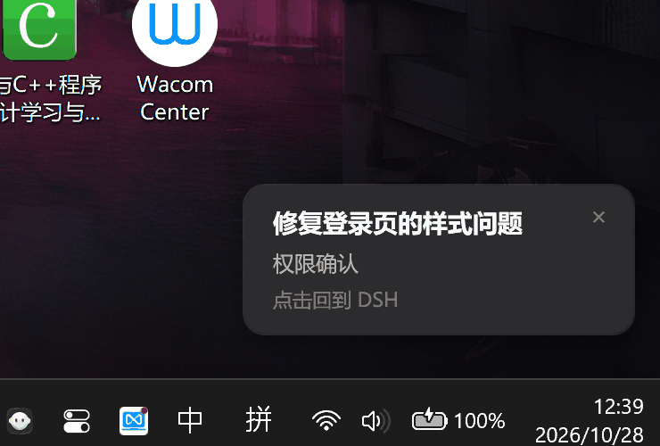

# dsh-popup-cards

[](LICENSE)
[](#环境要求)
[](https://github.com/topics/dsh-plugin)
[](https://github.com/topics/dsh-plugin)

在其它软件界面里也能收到 DeepSeek Harness 的提醒：需要权限、模型提问、计划待审、任务完成时，屏幕右下角弹出一张置顶卡片。

卡片长成 DSH 客户端的样子（深色面板、12px 圆角），不挡住你的工作，也不会卡住 agent 回合。它只显示两件事：**哪个任务**、**是哪种待确认**。

[English](README.md)



## 为什么做这个

DSH 本来就会在自己的窗口里提示审批和提问——但那时你正在别的软件里写代码、看网页、等构建，根本看不到。这个插件把「该你了」这件事搬到桌面上，并且给了一条最快的回去的路：

- **点卡片任意处** → DSH 窗口切到最前，卡片关闭。
- **点右上角 ×** → 只关卡片，不切回 DSH。
- **自己切回 DSH** → 卡片发现你已经回来了，自动关闭。
- **本来就在 DSH 里** → 不弹（应用内提示已经够了）。

卡片上不出现消息正文、工具参数或代码，只有任务名和待确认类型。

## 安装

环境：Windows 10/11、系统自带 PowerShell 5.1、DeepSeek Harness `>= 0.2.1-rc.2`。

**桌面端（推荐）**：设置 → 插件 → 安装，粘贴仓库地址：

```
https://github.com/Leo1958923515/dsh-popup-cards
```

**命令行**（desktop profile 由桌面端管理）：

```sh
dsh plugin --profile desktop add https://github.com/Leo1958923515/dsh-popup-cards
```

**本地目录**：

```sh
dsh plugin --profile desktop add link:D:\path\to\dsh-popup-cards
```

装完即生效：DSH 会热加载 profile 的 patch 文件，不用重启。

> 命名说明：仓库与插件包名都是 `dsh-popup-cards`，包名与 `cordis.patch.yml` 里的 `name:` 一致。按上面的地址安装即可；本地目录叫什么不影响加载。

> 仅支持 Windows。其它平台插件会正常加载，但弹窗会被跳过（DSH 日志里有一条警告）。

## 配置

全部可选。覆盖项写在 profile 的 `cordis.patch.yml` 里——config 是整体替换的，想保留默认值的键要一起写上：

```yaml
- id: popup-notify
  config:
    sound: true
    durationMs: 8000
    hintText: '点击回到 DSH'
```

| 配置项 | 默认 | 含义 |
| --- | --- | --- |
| `notifyOnApproval` | `true` | 工具等待权限确认时弹。 |
| `notifyOnQuestion` | `true` | 模型提问、或提交计划待审阅时弹。 |
| `notifyOnComplete` | `true` | 根 agent 从 `running` 落到 `idle` 时弹。 |
| `ignoreSubagents` | `true` | 子 agent、后台委派、workflow worker 不弹。 |
| `skipWhenDSHFocused` | `true` | DSH 窗口在前台时不弹。 |
| `dshWindowTitleMarker` | `— DeepSeek Harness` | 窗口标题里出现这段文字就认为是 DSH（标题形如 `会话名 — DeepSeek Harness`）。 |
| `activateDSHOnClick` | `true` | 点卡片先把 DSH 切到前台，再关卡片。 |
| `autoCloseOnDSHFocus` | `true` | 你自己切回 DSH 时，卡片自动关。 |
| `foregroundPollMs` | `400` | 卡片打开期间检测前台的间隔（毫秒，夹在 100–2000）。 |
| `sound` | `false` | 弹窗时播放系统提示音。 |
| `durationMs` | `0` | N 毫秒后自动关闭；`0` 表示常驻，点一下才关。 |
| `hintText` | `点击回到 DSH` | 第三行小字；设为 `''` 隐藏。 |
| `completeCooldownMs` | `10000` | 同一会话两次「任务完成」之间的最小间隔。 |
| `title` | `DeepSeek Harness` | 自检卡片显示的任务名。 |
| `testOnStart` | `false` | 加载时立刻弹一张，用来确认 PowerShell 通路可用。 |
| `traceFile` | `''` | 把诊断日志（为什么弹、为什么跳过、什么时候关）追加到这个文件。 |

### 自检

```yaml
- id: popup-notify
  config:
    testOnStart: true
```

重载后立刻弹一张。自检卡片跳过前台抑制、也不会自动关闭，方便你看样式；点卡片或点 × 关闭。改回 `false` 即不再自检。

## 行为细节

卡片是一个无边框、置顶的 WPF 窗口，宿主是一个短命的 `powershell.exe`（隐藏窗口、`-NonInteractive`、脚本经 `-EncodedCommand` 传入）。它贴在主屏工作区右下角上方 24px，不压任务栏，160ms 淡入。

- **同一时刻只有一张卡片**，后面的排队，当前这张关掉再弹下一张。
- **不抢焦点**，卡片自己不激活。
- **独立进程**：挂着的审批不会卡住回合；插件只监听进程退出，用来推进队列。
- **失败开放**：前台判断或 Win32 助手编译失败时照常弹卡片，检测坏了也不会吞掉提醒。
- **关掉卡片 ≠ 同意**：卡片只是提醒，审批和回答仍然要在 DSH 里完成。

窗口标题用「包含匹配」是有意的：桌面端标题是 `任务名 — DeepSeek Harness`，DSH 开在浏览器标签页时会再带浏览器名，两者都能命中 `dshWindowTitleMarker`。

## 工作原理

插件监听三个 Cordis 事件，不替换 DSH 自带的界面：

| 事件 | 含义 |
| --- | --- |
| `approval/request`（waterfall） | 工具等待审批。用 `prepend` 注册并始终 `next()`，内置审批桥照常作答。 |
| `tools/pre-execute`（waterfall） | `ask_user_question` → 提问；`exit_plan_mode` → 计划确认。始终 `next()`，工具照常执行。 |
| `agent/status` | 根 agent `running → idle` → 任务完成。 |

卡片第一行取会话标题（`ctx.get('sessionTitle')`），取不到退到工作目录名，再退到会话 id 前 8 位。

## 环境要求

- Windows 10 / 11。
- PowerShell 5.1（`powershell.exe`，系统自带）。
- DeepSeek Harness `>= 0.2.1-rc.2`。
- 没有任何 npm 依赖、原生模块、构建步骤，也不联网。

## 限制

- **只支持 Windows**：其它平台不弹（每次触发记一条日志）。
- **不能替你操作**：卡片无法批准/拒绝，只能告诉你「有东西在等」。
- **标题是启发式判断**：前台抑制与点击回 DSH 都靠窗口标题识别 DSH。改了窗口标题（自绘外壳、远程会话）就改 `dshWindowTitleMarker`，或关掉这两个开关。
- **不是通知中心**：没有历史、角标、分类样式——刻意保持「扫一眼就懂」。
- **PowerShell 冷启动**：出一张卡要付一次 `Add-Type`/WPF 的启动成本（几百毫秒），所以卡片是串行的，密集提醒会排队而不是并发抢屏。

## 开发

```sh
npm test          # node --test：纯函数 + 配置/元数据检查
npm run pack:check
```

测试不需要 Windows：断言生成的 PowerShell 脚本包含应有的门禁与处理器，并校验 locale/manifest；真正渲染卡片需要 Windows + PowerShell。

问题反馈：<https://github.com/Leo1958923515/dsh-popup-cards/issues>。

## 署名

本项目的起点是 [dsh-popup-notify](https://github.com/yiumanlenong/dsh-popup-notify)（MIT，作者 **yiumanlenong**）。上游版权声明原样保留在 [LICENSE](LICENSE) 里；卡片界面、交互模型和 [CHANGELOG.md](CHANGELOG.md) 里列出的修复是在本项目里加的。

## 许可

[MIT](LICENSE)
